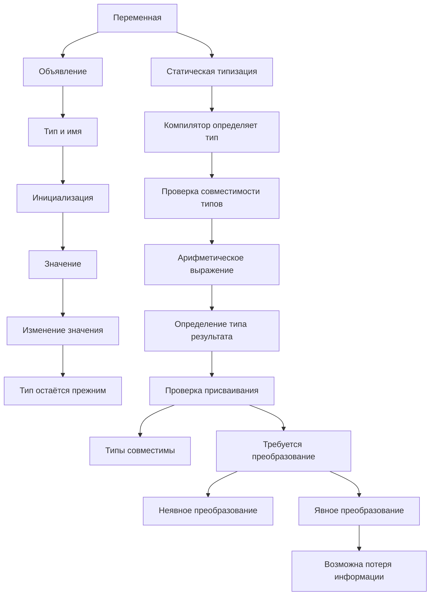

---

tags:

- C-sharp
    
- dotnet
    
- переменные
    
- типы-данных
    
- статическая-типизация  
source: "Учебный материал ChatGPT"

---
## 1. Что такое переменная

**Переменная** — именованная область хранения значения определённого типа, к которой можно обращаться по имени и изменять её значение в рамках правил языка.

Пример на PHP:

```
$health = 100;
```

Аналогичный код на C#:

```
int health = 100;
```

Разберём объявление:

- `int` — тип переменной.
    
- `health` — имя переменной.
    
- `100` — начальное значение.
    

Тип определяет, какие значения переменная может хранить и какие операции над ней допустимы.

## 2. Объявление и инициализация

**Объявление** — создание переменной с указанием её типа и имени:

```
int health;
```

**Инициализация** — первое присваивание значения переменной:

```
health = 100;
```

Можно совместить эти действия:

```
int health = 100;
```

После этого значение переменной можно менять:

```
int health = 100;

health = 75;
health = 40;
```

Тип переменной при этом остаётся `int`.

## 3. Статическая типизация

C# — статически типизированный язык.

Это означает, что тип переменной известен компилятору во время компиляции.

Например:

```
int health = 100;

health = 50;       // Допустимо
health = "Alive";  // Ошибка компиляции
```

Причина ошибки: переменная `health` объявлена как `int`, а строка `"Alive"` имеет тип `string`.

**Важно:** значение переменной может изменяться, но её объявленный тип не меняется.

## 4. Основные типы данных

Примеры распространённых типов:

```
int health = 100;
float movementSpeed = 5.5f;
double distance = 125.75;
string playerName = "Knight";
bool isAlive = true;
```

|Тип|Назначение|Пример|
|---|---|---|
|`int`|Целые числа|`100`|
|`float`|Дробные числа одинарной точности|`5.5f`|
|`double`|Дробные числа двойной точности|`125.75`|
|`string`|Строки|`"Knight"`|
|`bool`|Логические значения|`true`, `false`|

## 5. Почему bool лучше, чем string для логических состояний

Рассмотрим два варианта:

```
string isAlive = "true";
```

```
bool isAlive = true;
```

Второй вариант предпочтительнее.

Причины:

1. `bool` допускает только два значения: `true` и `false`.
    
2. Строка может содержать практически любой текст, включая ошибочные значения вроде `"tru"` или `"yes"`.
    
3. `bool` точнее выражает смысл переменной.
    
4. Логические операции естественно работают с `bool`.
    

**Принцип:** выбирай тип по смыслу хранимых данных, а не только по возможности сохранить в нём какое-либо значение.

## 6. Преобразование типов

В C# существуют неявные и явные преобразования типов.

### 6.1. Неявное преобразование

Компилятор самостоятельно выполняет преобразование, если оно разрешено правилами языка.

Например:

```
int number = 10;
float result = number;
```

Здесь `int` преобразуется в `float`.

Такое преобразование разрешено, поскольку диапазон `float` позволяет представить значения `int`, хотя для очень больших целых чисел может потеряться точность.

### 6.2. Явное преобразование

Когда преобразование может привести к потере информации, C# часто требует явно указать намерение программиста.

Пример:

```
float movementSpeed = 5.5f;

int speed = (int)movementSpeed;
```

Результат:

```
speed = 5
```

Запись `(int)` называется явным приведением типа.

**Важно:** преобразование из `float` в `int` отбрасывает дробную часть в направлении нуля. Это не округление.

Примеры:

|Выражение|Результат|
|---|---|
|`(int)5.9`|`5`|
|`(int)5.1`|`5`|
|`(int)-5.9`|`-5`|
|`(int)-5.1`|`-5`|

Для отрицательных чисел это особенно важно: `(int)-5.9` даёт `-5`, а не `-6`.

### 6.3. Почему компилятор разрешает потенциально опасное преобразование

```
float damage = 15.5f;

int damagePoints = (int)damage;
```

Компилятор разрешает такой код, потому что программист явно указал преобразование.

Это означает, что программист сознательно принимает возможную потерю дробной части.

**Явное преобразование не гарантирует сохранение информации.** Оно лишь показывает намерение программиста выполнить преобразование.

## 7. Тип результата арифметического выражения

Рассмотрим код:

```
int health = 100;
float damage = 15.5f;

health = health - damage;
```

Здесь возникает ошибка компиляции.

Причина не в самом присваивании как таковом, а в типе выражения:

```
health - damage
```

В операции участвуют:

- `health` — `int`;
    
- `damage` — `float`.
    

По правилам числовых преобразований C# целочисленный операнд преобразуется в `float`.

Следовательно:

```
100.0f - 15.5f
```

Результат имеет тип `float`.

Получается попытка присвоить `float` переменной `int`, что требует явного преобразования.

### Исправление №1: преобразование до вычисления

```
health = health - (int)damage;
```

Последовательность:

1. `damage` равно `15.5f`.
    
2. `(int)damage` даёт `15`.
    
3. Выполняется `100 - 15`.
    
4. Результат — `85`, тип `int`.
    

### Исправление №2: преобразование после вычисления

```
health = (int)(health - damage);
```

Последовательность:

1. `health` преобразуется в `float`.
    
2. Выполняется `100.0f - 15.5f`.
    
3. Получается `84.5f`.
    
4. Результат преобразуется в `int`.
    
5. Получается `84`.
    

### Сравнение

|Выражение|Результат|
|---|---|
|`100 - (int)15.5f`|`85`|
|`(int)(100 - 15.5f)`|`84`|

**Главный вывод:** место преобразования типа влияет на результат вычисления.

- `(int)damage` — преобразование до арифметической операции.
    
- `(int)(health - damage)` — преобразование после арифметической операции.
    

## 8. Как анализировать выражения с разными типами

При работе с арифметическими выражениями полезно соблюдать следующий порядок:

1. Определить тип каждого операнда.
    
2. Определить, какие преобразования выполняются перед операцией.
    
3. Определить тип результата выражения.
    
4. Проверить, совместим ли тип результата с типом переменной, которой присваивается значение.
    
5. Если требуется явное преобразование, определить, не приведёт ли оно к потере информации.
    

Не стоит смотреть только на числовой результат. В C# важен и тип этого результата.

---

## 9. Прогресс изучения

На данный момент освоено:

- Понятие переменной.
    
- Объявление и инициализация.
    
- Статическая типизация.
    
- Разница между изменением значения и изменением типа.
    
- Основные типы данных.
    
- Назначение `bool`.
    
- Неявные и явные преобразования.
    
- Приведение `float` к `int`.
    
- Разница между усечением и округлением.
    
- Тип результата арифметического выражения.
    
- Влияние порядка преобразований на результат.
    

## 10. Принципы, вызвавшие наибольшее количество вопросов

### Принцип 1. Тип переменной не меняется вместе со значением

```
int health = 100;
health = 50;
```

Значение изменилось, но тип остался `int`.

### Принцип 2. Тип выражения определяется до присваивания

```
int health = 100;
float damage = 15.5f;

health - damage
```

Результат имеет тип `float`, независимо от того, куда мы хотим его записать.

### Принцип 3. Явное преобразование может изменить значение

```
(int)15.9f
```

Результат — `15`, а не `16`.

### Принцип 4. Положение преобразования имеет значение

```
100 - (int)15.9f
```

Результат — `85`.

```
(int)(100 - 15.9f)
```

Результат — `84`.

Это два разных порядка вычисления, поэтому результат отличается.

---

## 11. Mermaid — схема понимания темы



**Итог:** переменные в C# имеют фиксированный объявленный тип. Типы влияют на допустимые операции, правила вычисления и присваивания. Преобразования позволяют работать с разными типами, но могут изменить значение данных.
